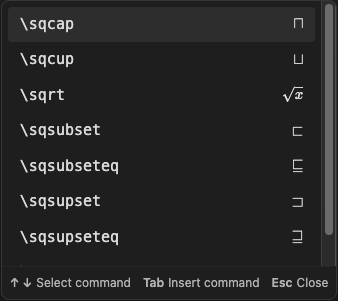

# MathJax Complete

LaTeX command completion for Obsidian math, with a preview beside each suggestion.

Type `\` inside `$...$` or `$$...$$` to open the command list, type more letters to filter the list, use the arrow keys to select a command, and press Tab to insert the command.



## Features

- Uses Obsidian's built-in suggestion list.
- Shows the full available command list after one backslash.
- Shows math previews on the right of each command.
- Uses short labels for invisible effects.
- Reads built-in commands from Obsidian's loaded MathJax system.
- Inserts required braces and puts the cursor in the first empty input.
- Includes templates for supported math environments.
- Works offline. Matching and previews run locally.

## Use

| Key | Action |
|---|---|
| `\` | Open suggestions inside math. |
| Letters | Filter by command-name prefix. Matching is case-sensitive. |
| Up / Down | Select a command in the list. |
| Tab / Enter | Insert the selected command. |
| Esc | Close the list. |

You can also click a suggestion to insert it. For example, type `\fr`, select `\frac`, and press Tab to insert `\frac{}{}`.

## Install

Requires Obsidian **1.14.5 or later**.

1. Download `main.js`, `manifest.json`, and `styles.css` from the [latest release](https://github.com/t0masGutierrez/mathjax-complete/releases/latest).
2. Create a `mathjax-complete` folder inside your vault's `.obsidian/plugins` folder.
3. Copy the three files into that folder.
4. Open or reload Obsidian.
5. Open **Settings → Community plugins** and enable **MathJax Complete**.

The plugin has been tested on macOS. Mobile use has not yet been tested.

## Development

Use Node.js 24 or later.

```sh
npm ci
npm test
npm run build
npm run check:release
```

MathJax is used as a test dependency. The installed plugin uses the MathJax system supplied by Obsidian.

To report a problem, [open an issue](https://github.com/t0masGutierrez/mathjax-complete/issues) with your Obsidian version, an example of the problem, and the result you expected.
